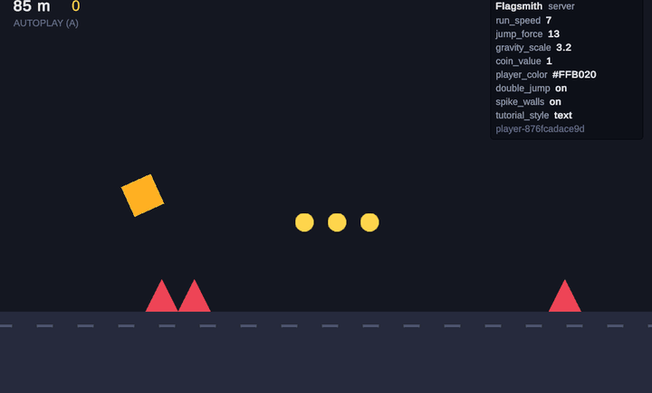
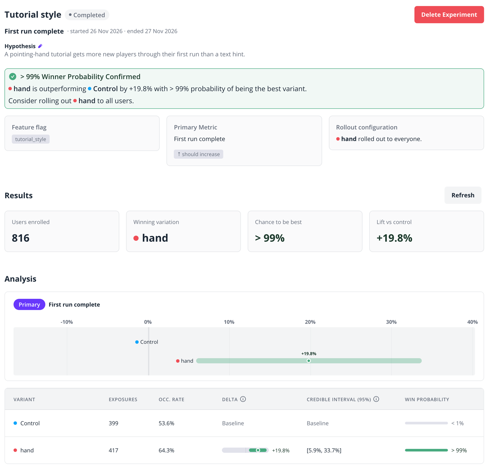

# Flagsmith for Unity

    [](https://github.com/Harindulk/flagsmith-unity/actions/workflows/tests.yml)

Feature flags, remote config and A/B tests for Unity games, powered by [Flagsmith](https://flagsmith.com).
Ship one build, give different players different versions of your game, and see in Flagsmith which version does better.
Change a jump height, switch off a broken feature or run an experiment on your tutorial without shipping a new build or waiting on store review.

Community package, MIT licensed. It is not an official Flagsmith SDK.



*The sample game playing itself while `server/demo.py` edits flags in a self-hosted Flagsmith. The build never changes.*

```csharp
[FlagsmithValue("run_speed")] float runSpeed = 7f;      // follows the flag, keeps 7 when offline

void Start() => flagsmith.Bind(this);

void OnTutorialShown() => flagsmith.GetExperimentFlag("tutorial_style");    // records who saw which variant
void OnLevelOneCleared() => flagsmith.TrackEvent("first_run_complete");     // the metric the experiment measures
```

Why it exists: Flagsmith has no Unity SDK. [Its FAQ](https://docs.flagsmith.com/support/faq/sdks-implementation) points Unity developers to the .NET SDK, which runs its polling and event flushing on `System.Threading.Timer`, `Task.Run` and `Task.Delay`, and those don't work in Unity WebGL builds. The Flagsmith team's own "Unity SDK" issue ([#3623](https://github.com/Flagsmith/flagsmith/issues/3623), March 2024) was closed as not planned in November 2026. Firebase Remote Config, Statsig, ConfigCat and Unity's own Remote Config all support Unity. This package is written for Unity from the start and also speaks Flagsmith's new Experimentation API.

## Toggle Wars: where to look

Built for [Flagsmith Toggle Wars](https://www.wemakedevs.org/hackathons/flagsmith), 26 to 29 November 2026. Everything below was written in that window.

**Try it without installing anything:** [play Flag Runner in your browser](https://harindulk.github.io/flagsmith-unity/#play) and move the flags beside it. That page runs the real package in a WebGL build against a stand-in for the Flagsmith API inside the page, so it needs no login. For the real thing, [two commands](#try-the-demo) start self-hosted Flagsmith 2.295.2 with the flags, a metric and a running experiment.

| Track | What it asks for | Where to see it |
|---|---|---|
| 1. Experimentation | A clear question, versions behind a flag, a metric from events, results you can explain | [The tutorial experiment](#ab-testing-with-flagsmith-experimentation): question, rule set in advance, result and the decision |
| 2. Agents | Flagsmith CLI, saves real time, a human approves changes, clear output | [One recorded agent run](docs/agent-run.md): 20 seconds from prompt to shipped winner, with every command and its output |
| 3. Open source | Self-hosted Flagsmith, integrations and developer tools, easy to reuse | [`server/`](server/) (pinned Docker Compose and a seed script), the [package](com.flagsmith.unity/) with its Editor window, and a [one-URL install](#install) |
| 4. Agent Skill | Completes the whole job, token efficiency, creative use of the CLI, safety around production | [`skills/flagsmith-unity`](skills/flagsmith-unity/SKILL.md) and the [token counts](docs/agent-run.md) for its demo run: 1,522 output tokens |

Tests: 26 for the package (run in the Unity Editor, one of them against a live self-hosted server) and 10 for the skill script, site and server helper (run on every push).

## What you get

- Flags and remote config for the whole environment or per player (identity), with traits, typed values (`GetValue<float>`, `int`, `bool`, `string`) and defaults.
- Live Tuning: `FlagsmithBehaviour` refreshes flags in the background and raises `FlagsChanged`. Fields marked `[FlagsmithValue]` update themselves. Edit a value in the dashboard or in the Unity Editor and a running build picks it up on its next refresh.
- Experimentation: `GetExperimentFlag` records a `$flag_exposure` when the player is enrolled in a running experiment, and `TrackEvent` records the conversions you measure. Events are batched, de-duplicated, capped at the API's 2 MiB batch limit, saved to disk when the app is paused and retried after network failures.
- Offline support: The last good response is cached on disk. Without a network the game starts with cached flags, and without a cache it uses your defaults.
- An Editor window (Window > Flagsmith) that lists an environment's flags and lets you toggle them and edit their values through the Management API.
- WebGL support: everything runs on Unity's main thread with `UnityWebRequest`, without background threads, `Task.Delay` or native plugins.
- Flagsmith Cloud and self-hosted Flagsmith.

## Install

Unity 6 (6000.0) or newer. In **Window > Package Manager > + > Install package from git URL**:

```
https://github.com/Harindulk/flagsmith-unity.git?path=/com.flagsmith.unity
```

Or add it to `Packages/manifest.json`:

```json
"com.flagsmith.unity": "https://github.com/Harindulk/flagsmith-unity.git?path=/com.flagsmith.unity"
```

The package depends on `com.unity.nuget.newtonsoft-json`, which Unity installs for you.

## Quick start

1. In Flagsmith, open your environment's **SDK keys** page and copy the **client-side** environment key. Never put a server-side key (`ser.…`) in a game; the client refuses one.
2. Add a `FlagsmithBehaviour` component to a GameObject in your first scene and paste the key. Leave the API URL as it is for Flagsmith Cloud, or set it to `http://your-host:8000/api/v1/` for self-hosted.
3. Read flags from any script:

```csharp
using Flagsmith;
using UnityEngine;

public class Player : MonoBehaviour
{
    [SerializeField] FlagsmithBehaviour flagsmith;

    [FlagsmithValue("run_speed")] float runSpeed = 7f;
    [FlagsmithValue("double_jump")] bool doubleJump;      // a bool follows the flag's on/off state

    void Awake() => flagsmith.Bind(this);                 // sets the fields now and after every change
}
```

Prefer plain calls? `flagsmith.Flags.GetValue("run_speed", 7f)` and `flagsmith.Flags.IsEnabled("double_jump")` work too, and `FlagsChanged` tells you when to read them again.

Flags arrive a moment after the game starts. Until the first fetch returns, reads give your defaults (or the cached values from the last session), and `GetExperimentFlag` records nothing. If something depends on a flag at startup, wait for the first `FlagsChanged`.

Package Manager also offers a **Quickstart** sample (select the package, then Samples > Import).

### Or let your coding agent do it

The repo ships an [Agent Skill](skills/flagsmith-unity/SKILL.md) for Claude Code, Codex, Cursor and other agents. It uses the [Flagsmith CLI](https://github.com/Flagsmith/flagsmith-cli) to create flags and experiments, edits your C# to bind fields, and waits for your OK before every change. It stays out of production unless you name the environment.

```sh
npx skills add Harindulk/flagsmith-unity
```

Then ask: *"Set up Flagsmith in this Unity game so I can tune it live"*, or later *"A/B test the tutorial and ship the winner"*. Agents without skills can follow the [setup steps](skills/flagsmith-unity/references/setup.md) from a pasted prompt; see [the guide](com.flagsmith.unity/Documentation~/index.md#set-up-with-an-ai-coding-agent).

## A/B testing with Flagsmith Experimentation

Create a multivariate flag, a metric and an experiment in the Flagsmith dashboard, then:

```csharp
// When the player actually sees the thing under test:
var tutorial = flagsmith.GetExperimentFlag("tutorial_style");   // "text" or "hand", exposure recorded
ShowTutorial(tutorial?.Value ?? "text");

// When the outcome you care about happens:
flagsmith.TrackEvent("first_run_complete");
flagsmith.TrackEvent("purchase", 4.99, new Dictionary<string, object> { ["item"] = "starter_pack" });
```

The dashboard then does the statistics.

### The demo experiment

**Question:** does a pointing-hand tutorial get more new players through their first run than a text hint?

| | |
|---|---|
| Flag | `tutorial_style`: `text` (control) or `hand`, split 50/50 by player ID |
| Exposure | `$flag_exposure`, sent at the moment the tutorial appears |
| Metric | `first_run_complete`, sent when a player reaches 100 m on their first run |
| Rule, set before looking | Ship a variant at 95% chance to be best, with at least 200 players per arm |
| Players | **Synthetic.** `server/simulate.py` sent 800 simulated players (named `sim-…`, every event tagged `synthetic: true`) through the same events API the game uses. The other 16 are our own test sessions |
| Result | `hand` 64.3% (268 of 417) against `text` 53.6% (214 of 399): +19.8% lift, 99.7% chance to be best, 95% interval +5.9% to +33.7% |
| Decision | The rule passed, so a coding agent using the [Agent Skill](skills/flagsmith-unity/SKILL.md) shipped `hand` to everyone through the same flag ([the recorded run](docs/agent-run.md)) |



*Synthetic data, simulated lift. `simulate.py` gives the hand variant a 62% finish rate and text 50% on purpose, to show the whole loop working: exposures, metric, statistics, then shipping the winner. It is not evidence about real players.*

An exposure is recorded only when the flag is on and the identity is enrolled (`Flag.InExperiment`), so players outside the experiment never skew the results. Each player keeps the same ID between sessions (stored in `PlayerPrefs`), so they stay in the same variant. Set your own ID in the component, for example your account system's user ID, when players sign in on several devices.

## Live Tuning

`FlagsmithBehaviour` refreshes every 60 seconds by default. While you tune, set **Refresh Seconds** to 1 or 2, open **Window > Flagsmith** next to the Game view, and change values while the game runs. Rows that changed are saved through the Management API, and the game picks them up on its next refresh. The Editor window needs an admin token (an Organisation API key or your user API token), which it keeps in `EditorPrefs` on your machine and never writes into the project.

Set the refresh back to 60 seconds or more for release builds. Every refresh is an API request per player.

## Try the demo

The repository includes a self-hosted Flagsmith setup with Experimentation turned on, a seed script and a small runner game, **Flag Runner**, that uses every feature above. You need Docker, Python 3 and Unity 6000.6.

```sh
cd server
docker compose up -d          # Flagsmith on http://localhost:8000 (first start takes a minute)
python3 seed.py               # project, 8 flags, a metric and a running 50/50 experiment
```

This setup is for local demos only. It uses the default secrets from Flagsmith's compose file, allows any host, and `seed.py` creates an admin with a fixed password. For a real deployment follow [Flagsmith's self-hosting guide](https://docs.flagsmith.com/deployment-self-hosting) and set your own `DJANGO_SECRET_KEY`, database password, `DJANGO_ALLOWED_HOSTS` and admin account.

Then open `Sample/` in Unity and press Play, or build WebGL with
`unity build Sample --target WebGL --execute-method SampleBuild.WebGL -o Builds/WebGL`.

Hands-free version for recording: press **A** in the game (or open the WebGL build with `?autoplay`) so it plays itself, then run `python3 demo.py`. It changes the flags below on a timeline and restores them at the end. Every change shows a caption in the game.

Other tools in `server/`:

| Command | Does |
|---|---|
| `python3 flag.py` | Lists every flag and its value |
| `python3 flag.py run_speed 12` | Sets a value (`on` / `off` toggles a flag) |
| `python3 simulate.py 400 [first]` | Sends 400 synthetic players (IDs from `sim-<first>`) through the tutorial experiment and refreshes its results |

What to try while it runs:

| Flag | Try | What happens |
|---|---|---|
| `run_speed` | 7 → 12 | The run speeds up within ~2 seconds |
| `gravity_scale`, `jump_force` | any number | Jumps feel floatier or heavier |
| `player_color` | `#4DD0E1` | The player changes colour |
| `spike_walls` | off | Kill switch: the red walls disappear mid-run |
| `double_jump` | on | A second jump in the air |
| `tutorial_style` | experiment | Half of players see text, half see a tap hint; reaching 100 m sends `first_run_complete` |

The panel in the corner shows the live values and highlights the ones that just changed. `seed.py` prints the dashboard login, and it writes the connection details the sample needs into `Sample/Assets/Resources/flagsmith.json`, which git ignores.

## How it works

| Piece | Role |
|---|---|
| `FlagsmithClient` | Plain C# client: environment and identity flags, cache, retries, event queue. Use it directly if you don't want a component. |
| `FlagsmithBehaviour` | The component: picks the identity, refreshes flags, raises `FlagsChanged`, flushes events every 10 s and on pause, focus loss and quit. |
| `[FlagsmithValue]` | Binds fields and properties to flags through `Bind(target)`. |
| `EventBuffer` | Queues events, drops exposure duplicates, splits batches at 2 MiB, discards events older than the API's 10-day limit. |
| `FileFlagCache` | Last good response per identity under `Application.persistentDataPath/flagsmith`. |
| `FlagsmithWindow` | Editor window over the Management API. |

Requests go to `<API URL>flags/` and `<API URL>identities/` with the `X-Environment-Key` header, the same endpoints the official client SDKs use. Events go to Flagsmith Cloud's events API, or to `<API URL>events/` on a self-hosted server.

The full guide and API reference are in [Documentation~/index.md](com.flagsmith.unity/Documentation~/index.md).

## Platform support

| Platform | Status |
|---|---|
| Unity Editor (macOS) | Tested: 26 automated tests, including one against a live self-hosted server (Flagsmith 2.295.2, pinned in `server/docker-compose.yml`) |
| WebGL | Tested: Flag Runner build in Chrome, Live Tuning and experiment events confirmed in Flagsmith. The hosted playground is a 5 MB download; that build uses WebAssembly 2023 features, so it needs a 2023 or newer browser (Safari 16.4+) |
| Android | IL2CPP ARM64 release build fetched its flags from the self-hosted server on an Android 16 emulator. Not yet tried on a physical phone |
| iOS, Windows, macOS, Linux players | Uses only `UnityWebRequest` and main-thread code, but not yet tested |

Experimentation was tested against self-hosted Flagsmith. Flagsmith Cloud uses the events endpoint of the official SDKs, which this package has not been tested against yet.

## Known limits

- Flags refresh by polling. Flagsmith's real-time updates are not used yet.
- A WebGL tab closed without losing focus first can drop events from the last 10 seconds.
- Local evaluation (server-side keys, evaluating flags in the client) is deliberately not supported; game builds can be unpacked, so they only get client-side keys.

## Repository layout

```
com.flagsmith.unity/   the Unity package (Runtime, Editor, Tests, Samples~, Documentation~)
Sample/                Unity project with the Flag Runner demo
server/                docker-compose for self-hosted Flagsmith and the seed script
skills/                Agent Skill for coding agents (setup and A/B tests through the Flagsmith CLI)
site/                  the docs site and its in-browser playground
```

## Contributing

Issues and pull requests are welcome. See [CONTRIBUTING.md](CONTRIBUTING.md) for running the tests.

## License

[MIT](LICENSE)
