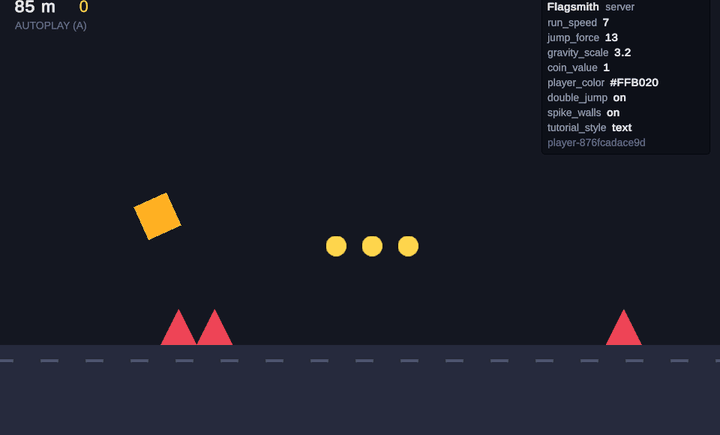
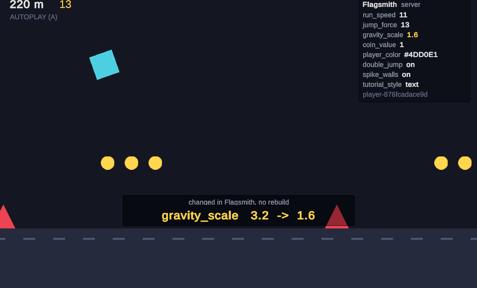
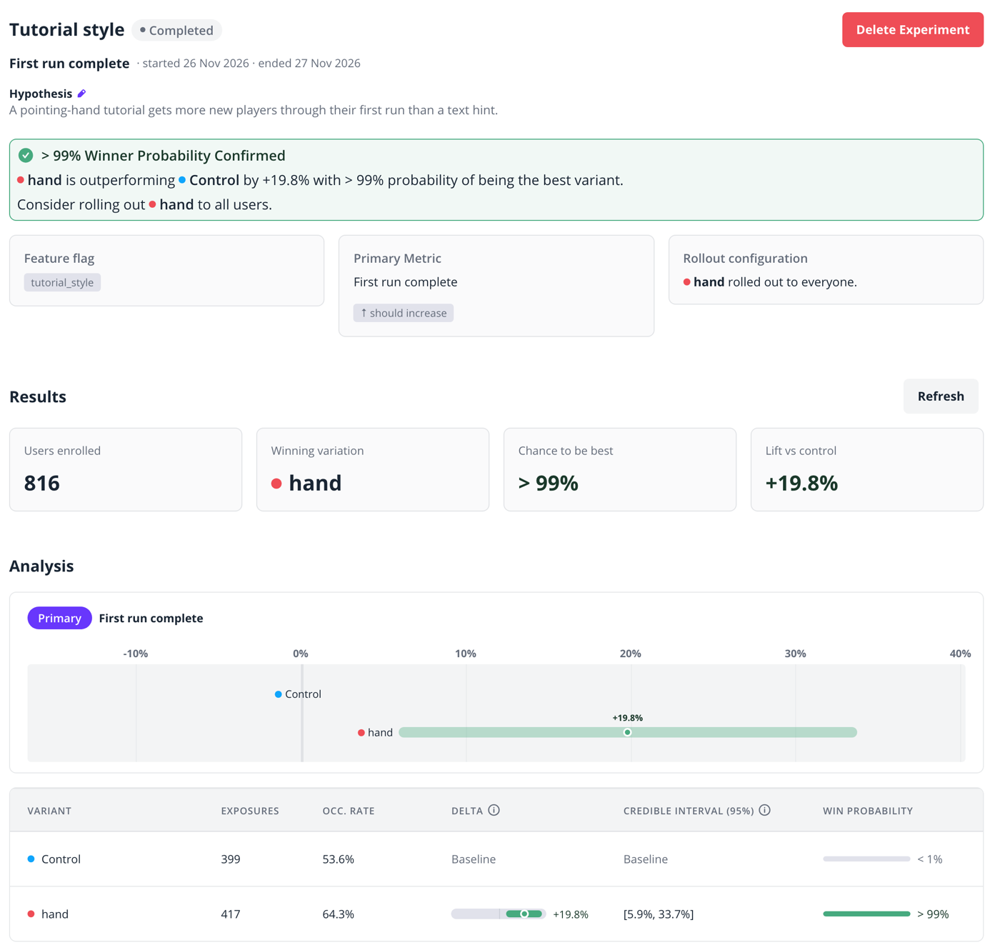
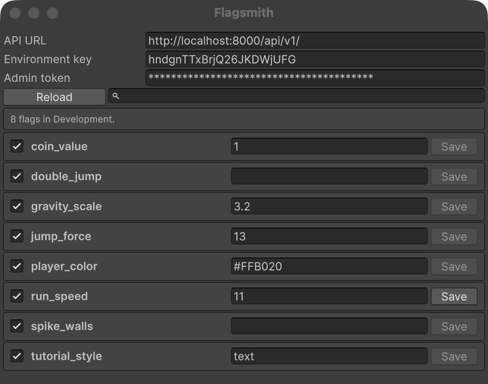
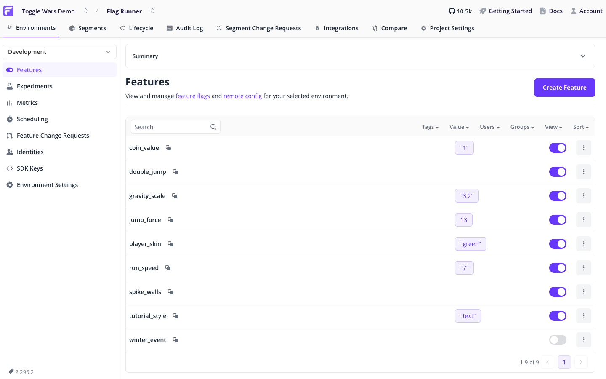

# Flagsmith for Unity: guide and API reference

Version 0.1.0.

- [Getting started](#getting-started)
- [Setup](#setup)
- [Reading flags](#reading-flags)
- [Identities and traits](#identities-and-traits)
- [Live tuning](#live-tuning)
- [Experimentation](#experimentation)
- [Offline behaviour](#offline-behaviour)
- [The Editor window](#the-editor-window)
- [Using the client without the component](#using-the-client-without-the-component)
- [Security](#security)
- [API reference](#api-reference)
- [Troubleshooting](#troubleshooting)
- [Set up with an AI coding agent](#set-up-with-an-ai-coding-agent)
- [Run the demo](#run-the-demo)

## Getting started

Flagsmith for Unity connects Unity games to [Flagsmith](https://flagsmith.com), the open-source feature flag service. A game reads its tuning, switches and experiment variants from Flagsmith at runtime, so you can change them without a new build. It works with Flagsmith Cloud and self-hosted Flagsmith, and everything runs on Unity's main thread, so WebGL builds work too.



*The sample game, Flag Runner, while `server/demo.py` edits its flags. Nothing is rebuilt or restarted.*

### Install

Unity 6 (6000.0) or newer. In **Window > Package Manager > + > Install package from git URL**, paste:

```
https://github.com/Harindulk/flagsmith-unity.git?path=/com.flagsmith.unity
```

Or add it to `Packages/manifest.json`:

```json
"com.flagsmith.unity": "https://github.com/Harindulk/flagsmith-unity.git?path=/com.flagsmith.unity"
```

Unity also installs `com.unity.nuget.newtonsoft-json`, which the package depends on.

### Five minutes to your first flag

1. In Flagsmith, create a flag called `run_speed` with the value `7`.
2. Open your environment's **SDK keys** page and copy the **client-side** environment key.
3. Add a `FlagsmithBehaviour` component to a GameObject in your first scene and paste the key. Leave the API URL as it is for Flagsmith Cloud, or set it to `http://your-host:8000/api/v1/` for self-hosted.
4. Bind a field to the flag:

```csharp
using Flagsmith;
using UnityEngine;

public class Player : MonoBehaviour
{
    [SerializeField] FlagsmithBehaviour flagsmith;

    [FlagsmithValue("run_speed")] float runSpeed = 7f;   // 7 until the first fetch, and offline

    void Awake() => flagsmith.Bind(this);
}
```

5. Press Play, change `run_speed` in Flagsmith, and the field follows on the next refresh.

Package Manager also has a **Quickstart** sample: select the package, then **Samples > Import**.

## Setup

Add `FlagsmithBehaviour` to a GameObject that lives for the whole session (your bootstrap scene, or call `DontDestroyOnLoad` on it). Inspector fields:

| Field | Default | Notes |
|---|---|---|
| Environment Key | | The client-side key from the environment's SDK keys page |
| Api Url | `https://edge.api.flagsmith.com/api/v1/` | Self-hosted: `http://your-host:8000/api/v1/` |
| Events Url | empty | Empty sends events to Flagsmith Cloud's events API, or to `<Api Url>events/` when self-hosted |
| Retry Delay Seconds | 1 | Wait before the single retry of a failed request (real time, so a paused game still retries) |
| Identifier | empty | Empty generates a random ID once and keeps it in `PlayerPrefs` |
| Refresh Seconds | 60 | 0 fetches once at startup. 1-2 while tuning |
| Flush Seconds | 10 | How often queued events are sent |

To configure from code instead, add the component and call `Init` straight away:

```csharp
var flagsmith = gameObject.AddComponent<FlagsmithBehaviour>();
flagsmith.Init(new FlagsmithOptions { EnvironmentKey = "your-client-key" }, id: accountId, refresh: 60f);
```

The first fetch starts as soon as the component starts. Until it returns, `Flags` is empty and every read returns your fallback, so always pass a sensible default.

## Reading flags

```csharp
Flags flags = flagsmith.Flags;

bool on      = flags.IsEnabled("new_shop");            // false when missing
float speed  = flags.GetValue("run_speed", 7f);        // 7 when missing, null or not a number
string label = flags.GetValue("cta_text", "Play");
Flag raw     = flags.Get("run_speed");                 // null when missing; raw.Value is the text value
FlagSource s = flags.Source;                           // Server, Cache or Defaults
```

`GetValue<T>` converts with the invariant culture, so `"3.5"` reads as 3.5 on a device set to a comma-decimal locale. For `bool`, it parses the value. Use `IsEnabled` for the flag's on/off state.

### Binding fields with `[FlagsmithValue]`

```csharp
[FlagsmithValue("run_speed")] float runSpeed = 7f;
[FlagsmithValue("lives")] public int Lives { get; private set; } = 3;
[FlagsmithValue("double_jump")] bool doubleJump;

void Awake() => flagsmith.Bind(this);
```

- `bool` members follow the flag's enabled state. Every other type takes the flag's value, converted like `GetValue<T>`.
- A member whose flag is missing, or whose value doesn't convert, keeps its current value. Your initialiser is the offline default.
- Fields and properties can be private. Inherited members are bound too.
- Binding a `MonoBehaviour` stops by itself after the object is destroyed.

### Reacting to changes

```csharp
flagsmith.FlagsChanged += flags => ui.SetShopVisible(flags.IsEnabled("new_shop"));
```

`FlagsChanged` runs on the main thread after the first successful fetch and whenever a flag's state, value or variant changes. It does not run when a refresh returns the same flags.

## Identities and traits

Every `FlagsmithBehaviour` asks for flags as one identity, so segments, per-player overrides and experiments all work. Traits go in the `Traits` dictionary and are sent with the next refresh:

```csharp
flagsmith.Traits["level"] = 12;
flagsmith.Traits["platform"] = Application.platform.ToString();
flagsmith.Traits["payer"] = true;
await flagsmith.Refresh();   // optional: apply now instead of waiting for the next refresh
```

## Live tuning

Set Refresh Seconds to 1 or 2, enter Play mode (or run a development build on a phone), and change values in the dashboard or in Window > Flagsmith. The game picks them up within one refresh. Bound fields update, and `FlagsChanged` fires.

Every refresh is one request per player, so set Refresh Seconds back to 60 or more before release.



*Flag Runner shows each change as it arrives. The panel on the right lists the live values and where they came from.*

## Experimentation

Flagsmith Experimentation compares the variants of a multivariate flag against a metric built from events your game sends. The flow:

1. In the dashboard, create a multivariate flag (for example `tutorial_style` with variants `text` and `hand`), a metric on an event (`first_run_complete`, aggregated by occurrence) and an experiment that uses both. Start it.
2. When the player actually sees the variant, call `GetExperimentFlag`. It returns the flag and records a `$flag_exposure` event if the player is enrolled.
3. When the outcome happens, call `TrackEvent`.

```csharp
var tutorial = flagsmith.GetExperimentFlag("tutorial_style");
ShowTutorial(tutorial?.Value ?? "text");
...
flagsmith.TrackEvent("first_run_complete", distance, new Dictionary<string, object> { ["level"] = 1 });
```

Details that matter for clean results:

- Call `GetExperimentFlag` at the moment of exposure, not at startup. A player who never opens the shop shouldn't count as exposed to the shop experiment.
- Calling it again is harmless. A duplicate exposure (same flag, identity, variant and experiment) is dropped until the first one has been delivered.
- No exposure is recorded when the flag is off, the identity isn't enrolled, or there is no running experiment on the flag.
- Event names starting with `$` are reserved, and `TrackEvent` throws for them.
- `value` is sent as text (numbers with the invariant culture). `metadata` is any JSON-serialisable dictionary. The client adds `sdk_version`.

After enough players, the experiment's page in Flagsmith shows the result:



*Self-hosted Flagsmith after `server/simulate.py` sent 400 synthetic players through the demo experiment. The lift is simulated on purpose to show the page working; it says nothing about real players.*

### Delivery

Events wait in a queue and are sent every Flush Seconds, and also when the app is paused, loses focus or quits. Before sending on pause and quit, the queue is written to disk, so an app the OS kills in the background sends its events on the next launch.

| Situation | What happens |
|---|---|
| Network error or HTTP 5xx | Retried once, then the batch goes back in the queue for the next flush |
| HTTP 4xx | The batch is dropped and an error is logged (retrying would fail the same way) |
| Queue over 10,000 events | The oldest are dropped |
| Event older than 10 days | Dropped before sending (the API rejects it) |
| Batch over 2 MiB | Split into several requests |

## Offline behaviour

Every successful flags response is cached on disk per environment and identity (`Application.persistentDataPath/flagsmith`). When a request fails:

1. The cached response for that identity is used (`Flags.Source == FlagSource.Cache`).
2. With no cache, flags are empty (`FlagSource.Defaults`) and every read returns your fallback.

A response that isn't a flags payload counts as a failure and is never cached: a hotel Wi-Fi login page, or a proxy's JSON error such as `{"detail": "Maintenance"}`. While running, `FlagsmithBehaviour` keeps the last good flags rather than replacing them with empty defaults.

## The Editor window

Window > Flagsmith lists the flags of one environment and lets you change them.



| Field | What to enter |
|---|---|
| API URL | `https://api.flagsmith.com/api/v1/` for Cloud (the Management API, not the edge URL), or your self-hosted `/api/v1/` |
| Environment key | The client-side key of the environment to edit |
| Admin token | An Organisation API key, or your user API token from Account settings |

The fields are stored in `EditorPrefs`, which is per user and per machine, so the admin token never ends up in your project or in version control. Edit the toggle or the value, then press Save on that row. Segment and identity overrides aren't shown; edit those in the dashboard.

## Using the client without the component

`FlagsmithClient` is plain C# and works from any async code on the main thread:

```csharp
var client = new FlagsmithClient(new FlagsmithOptions { EnvironmentKey = key });
Flags env = await client.GetEnvironmentFlags();
Flags mine = await client.GetIdentityFlags("player-42", new Dictionary<string, object> { ["level"] = 3 });
Flag variant = await client.GetExperimentFlag("tutorial_style", "player-42");
client.TrackEvent("first_run_complete", "player-42");
await client.FlushEvents();      // you own flushing and SaveEvents() when not using the component
```

For tests, pass your own `ITransport` (see `FakeTransport` in the package tests) and `MemoryFlagCache`.

## Security

- Ship only client-side environment keys. They can read flags and nothing else. The client throws `ArgumentException` for a server-side key (`ser.…`).
- Don't put secrets in flag values. Anyone with the client key can read every environment flag.
- The admin token used by the Editor window can change flags. It stays in `EditorPrefs`; don't copy it into scripts or ScriptableObjects.

## API reference

### `FlagsmithBehaviour` (MonoBehaviour)

| Member | Description |
|---|---|
| `Flags Flags` | The latest flags. Empty until the first fetch |
| `string Identifier` | The identity flags are fetched for |
| `IDictionary<string, object> Traits` | Traits sent with every refresh |
| `FlagsmithClient Client` | The underlying client |
| `event Action<Flags> FlagsChanged` | First fetch and every change |
| `void Init(FlagsmithOptions, string id = null, float refresh = 60)` | Configure from code, right after `AddComponent` |
| `void Bind(object target)` | Keep `[FlagsmithValue]` members in sync |
| `Flag GetExperimentFlag(string name)` | The flag, recording an exposure if enrolled |
| `void TrackEvent(string name, object value = null, IDictionary<string, object> metadata = null)` | Queue an event for this identity |
| `Task Refresh()` | Fetch now |

### `FlagsmithClient`

| Member | Description |
|---|---|
| `FlagsmithClient(FlagsmithOptions, ITransport = null, IFlagCache = null, Func<long> nowMs = null)` | Throws for a missing or server-side key. Loads events saved by a previous session |
| `Task<Flags> GetEnvironmentFlags()` | Environment defaults |
| `Task<Flags> GetIdentityFlags(string identifier, IDictionary<string, object> traits = null)` | Flags for one identity |
| `Task<Flag> GetExperimentFlag(string name, string identifier, IDictionary<string, object> traits = null)` | Fetch and record an exposure |
| `void TrackExposure(Flag flag, string identifier)` | Record an exposure for a flag you already have |
| `void TrackEvent(string name, string identifier = null, object value = null, IDictionary<string, object> metadata = null)` | Queue an event |
| `Task FlushEvents()` | Send the queue now |
| `void SaveEvents()` | Write the queue to the cache |
| `int PendingEvents` | Events waiting to be sent |

### `Flags` and `Flag`

| Member | Description |
|---|---|
| `Flags.Source` | `Server`, `Cache` or `Defaults` |
| `Flags.All` | Every flag |
| `Flags.Get(name)` | A `Flag`, or null |
| `Flags.IsEnabled(name)` | The on/off state, false when missing |
| `Flags.GetValue<T>(name, fallback)` | The converted value, or the fallback |
| `Flag.Name`, `Enabled`, `Value` | Value is text, or null |
| `Flag.Variant` | The multivariate option key, for example `control` |
| `Flag.ExperimentId`, `ExperimentName`, `InExperiment` | Set when an experiment runs on the flag |

## Troubleshooting

| Symptom | Cause |
|---|---|
| `Flags.Source` is always `Defaults` | Wrong API URL or key, or no network. The Console shows a `[Flagsmith] ... failed` warning with the HTTP status |
| Events return 404 "does not store events" (self-hosted) | Experimentation is off, or the environment has no warehouse connection. See `server/seed.py` for the setup |
| `GetExperimentFlag` records nothing | The experiment isn't running, the flag is off, or the multivariate options have no `key` (then `Variant` is null) |
| Values change in the dashboard but not in the game | Refresh Seconds is 0 or large, or you're editing a different environment |
| Editor window: 401 or 403 | The admin token is wrong, or it's a user token used with the `Api-Key` scheme. Organisation keys contain a dot; user tokens don't |
| WebGL: requests blocked | The server must allow CORS for the game's origin and the `X-Environment-Key` header. Flagsmith Cloud and the default self-hosted image do |

## Set up with an AI coding agent

Coding agents such as Claude Code, Codex, Cursor and Gemini CLI can do the whole setup for you: install the package, create the flags with the [Flagsmith CLI](https://github.com/Flagsmith/flagsmith-cli), bind your fields, and later run an A/B test and ship the winner.

### Install the Agent Skill

The repository ships an [Agent Skill](https://agentskills.io) in `skills/flagsmith-unity`. Install it into your project with:

```sh
npx skills add Harindulk/flagsmith-unity
```

Or copy the `skills/flagsmith-unity` folder into your agent's skills folder (for Claude Code, `.claude/skills/`). Then ask in plain words, for example "Set up Flagsmith in this Unity game so I can tune it live" or "A/B test the tutorial and ship the winner".

### Or paste this prompt

Agents without skill support can follow the same steps from a prompt:

```text
Add Flagsmith to this Unity project with the Flagsmith for Unity package.
Follow https://raw.githubusercontent.com/Harindulk/flagsmith-unity/main/skills/flagsmith-unity/references/setup.md step by step.
Use my Development environment, show me the flags you want to create and wait for my OK,
and never put a server-side key, Master API key or token in the project.
```

### What the agent will and won't do

- It reads first (`flagsmith auth status`, `flagsmith config`) and tells you which project and environment it will change.
- Every write waits for your OK. The experiment script refuses to change anything until it is re-run with your approval, and an environment named like production needs its exact name typed out.
- Only the client-side environment key goes into the game. Credentials stay in the CLI's keyring or your shell.
- It never deletes features, segments or experiments unless you ask for that exact deletion.

The docs site also serves [llms.txt](https://harindulk.github.io/flagsmith-unity/llms.txt) and [llms-full.txt](https://harindulk.github.io/flagsmith-unity/llms-full.txt), so an agent can read the whole guide in one request.

## Run the demo

The repository has a self-hosted Flagsmith setup with Experimentation turned on, a seed script and the sample game, Flag Runner, which uses every feature in this guide. You need Docker, Python 3 and Unity 6000.6.

```sh
cd server
docker compose up -d          # Flagsmith on http://localhost:8000 (the first start takes a minute)
python3 seed.py               # project, 8 flags, a metric and a running 50/50 experiment
```

`seed.py` prints the dashboard login and writes the connection details the sample needs into `Sample/Assets/Resources/flagsmith.json`, which git ignores. Open `Sample/` in Unity and press Play.



To record or present it hands-free, press **A** in the game so it plays itself, then run `python3 demo.py`. It changes speed, colour, gravity, the spike walls and coin value on a timeline, then puts everything back.

| Command | Does |
|---|---|
| `python3 flag.py` | Lists every flag and its value |
| `python3 flag.py run_speed 12` | Sets a value (`on` / `off` toggles a flag) |
| `python3 demo.py` | Runs the scripted live-tuning timeline |
| `python3 simulate.py 400` | Sends 400 synthetic players through the tutorial experiment and refreshes its results |

> This setup is for local demos only. It uses the default secrets from Flagsmith's compose file, allows any host, and `seed.py` creates an admin with a fixed password. For a real deployment, follow [Flagsmith's self-hosting guide](https://docs.flagsmith.com/deployment-self-hosting).

You can also play Flag Runner in the browser on the [project site](../../README.md), where the page itself answers the game's Flagsmith requests.
